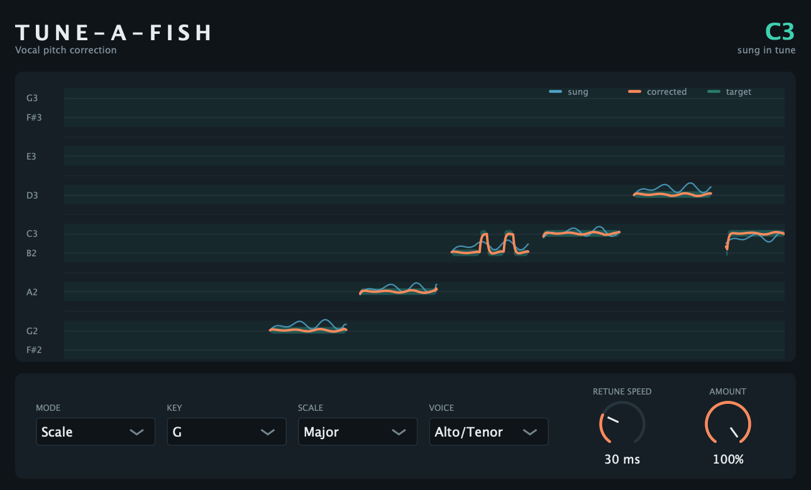

# Tune-a-Fish

A pitch-correction plugin for vocals. It listens to a single voice and pulls each note onto the nearest note of a key and scale, or onto whatever note you play over MIDI. Use it gently to tidy up a take, or set it to instant for the hard, robotic effect.



## Building (macOS)

### Requirements

- Apple's Command Line Tools: `xcode-select --install`. Full Xcode is optional.
- CMake 3.22 or newer. Without Homebrew, download the macOS `.dmg` from [cmake.org/download](https://cmake.org/download/), drag CMake to Applications, then add this line to `~/.zshrc` and open a new terminal:

  ```sh
  export PATH="/Applications/CMake.app/Contents/bin:$PATH"
  ```

- An internet connection the first time you build. CMake downloads JUCE (about 1–2 minutes).

### Build

```sh
cmake -B build -DCMAKE_BUILD_TYPE=Release
cmake --build build --parallel
```

The plugin is installed automatically after every build:

| Format | Installed to |
| --- | --- |
| VST3 | `~/Library/Audio/Plug-Ins/VST3/Tune-a-Fish.vst3` |
| AU | `~/Library/Audio/Plug-Ins/Components/Tune-a-Fish.component` |

To build without installing, add `-DTUNEAFISH_COPY_PLUGIN=OFF` to the first command.

**After rebuilding, restart Live.** Live keeps the old version of a plugin in memory until it quits.

### Tests

The build also makes a test program that runs synthetic voices through the corrector and measures the result:

```sh
ctest --test-dir build --output-on-failure
```

## Using it in Ableton Live

**Use the VST3 version in Live.** The instructions below are for the VST3. MIDI mode needs MIDI routed into the plugin, and the AU version hasn't been tried for that.

### One-time setup

1. Open **Live → Settings → Plug-Ins** (called Preferences in older Live versions).
2. Turn on **Use VST3 Plug-In System Folders**.
3. Click **Rescan**.

### Scale mode: tune to a key

1. Drag **Plug-Ins → VST3 → Tune-a-Fish** onto your vocal track.
2. Set **Key** and **Scale** to match the song. If you're not sure of the key, leave the scale on **Chromatic**: every note is allowed, so each note just goes to the nearest semitone.
3. Set **Voice** to the singer's range.
4. Play. The graph shows what's being sung (blue) and what comes out (coral).

### MIDI mode: tune to the notes you play

In MIDI mode, the voice goes to whichever MIDI note is held. Draw the melody in a MIDI clip, or play it on a keyboard.

```
Track 1 "Melody" (MIDI)                Track 2 "Vocals" (audio)
┌───────────────────────────┐          ┌────────────────────────┐
│ MIDI clip with the melody │  notes   │ Tune-a-Fish (VST3)     │
│ MIDI To: 2-Vocals         │ ───────► │ Mode: MIDI             │
│          Tune-a-Fish      │          │                        │
└───────────────────────────┘          └────────────────────────┘
```

1. Put Tune-a-Fish on the vocal track and set **Mode** to **MIDI**.
2. **Show the routing controls**: turn on **View → In/Out** (or press `⌘ ⌥ I`).
3. Create a MIDI track for the melody. It doesn't need an instrument.
4. On the MIDI track, set **MIDI To**:
   - top dropdown: the vocal track (for example **2-Vocals**)
   - bottom dropdown: **Tune-a-Fish**
5. Draw the melody in a clip on the MIDI track, or arm the track and play a keyboard.

Notes to know:

- The voice goes to the exact note you play, octave included. Play the melody in the octave it's sung in. A note an octave away shifts the voice by an octave.
- If several notes are held, the most recent one wins.
- While no note is held, the voice passes through uncorrected.

### Latency

Tune-a-Fish delays the audio by about 40 ms, so it can see a little way ahead when it rebuilds the voice. It tells Live about the delay, and Live shifts everything else to match, so playback stays in sync. You'll only notice the delay if you sing through it live. For recording, monitor without it and add it afterwards.

## The window

**The graph** scrolls right to left and shows the last five seconds:

- **Blue**: the pitch as sung.
- **Coral**: the pitch after correction.
- **Teal bars**: the note each moment is being pulled to.
- **Shaded rows**: the notes of the current key and scale. In MIDI mode every note is labelled, since any note can be a target.

The view follows the singer up and down. Gaps in the lines are moments with no pitch to correct: breaths, consonants like "s" and "t", and silence. Those pass through untouched.

**The top-right corner** shows the note being tuned to, and how far off the singer was before correction ("sung 23¢ sharp"). A cent is a hundredth of a semitone.

**Knobs**: drag up or down to change them, double-click to reset, or click the value to type one.

## Controls

| Control | Range | What it does |
| --- | --- | --- |
| Mode | Scale, MIDI | Where the target notes come from: the key and scale, or the MIDI note you hold. |
| Key | C–B | The key of the song. Scale mode only. |
| Scale | Chromatic, Major, Minor, Harmonic minor, Major pentatonic, Minor pentatonic, Blues | The notes the voice may land on. Chromatic allows all twelve. Minor is the natural minor. Scale mode only. |
| Voice | Soprano (150–1100 Hz), Alto/Tenor (90–750 Hz), Low (70–450 Hz) | The range to look for the pitch in. Pick the narrowest one that fits the singer; it avoids octave mistakes. |
| Retune speed | Instant–400 ms | How long it takes to pull a note onto its target. **Instant** snaps immediately: the robotic effect. 20–80 ms sounds natural on most vocals. Slower settings leave vibrato and slides alone and only correct notes that stay off-pitch. Default 50 ms. |
| Amount | 0–100% | How much of the correction to apply. 50% moves every note halfway to its target. |

Note names use Live's convention, where middle C (MIDI 60) is C3.

### Recipes

- **Hard effect**: Retune speed **Instant**, Amount **100%**, Scale set to the song's key (or Chromatic).
- **Natural touch-up**: Retune speed **50–100 ms**, Amount **70–100%**, Key and Scale set to the song.
- **Gentle drift fix**: Retune speed **200–400 ms**. Vibrato and slides survive. Only notes that sit off-pitch get pulled in.

## Tuning files from the command line

The build also makes `tune-a-fish`, a command-line tool that runs the same corrector over an audio file. It's handy for trying settings quickly, or for checking what the pitch detector hears.

```sh
TUNE=build/TuneAFishCli_artefacts/Release/tune-a-fish

# Tune a vocal to G major, with a natural retune speed
$TUNE vocal.wav tuned.wav --key G --scale major --retune 60

# The hard effect, for a low voice
$TUNE vocal.wav robot.wav --retune 0 --voice low

# Tune to the notes in a MIDI file
$TUNE vocal.wav tuned.wav --midi melody.mid

# Print the detected pitch every 10 ms
$TUNE vocal.wav --pitch
```

It reads WAV, AIFF and FLAC files, and on macOS also M4A. It writes a 24-bit WAV at the input's sample rate, lined up exactly with the input (the 40 ms delay is removed). Run it with `--help` for all the options.

## How it works

1. **Find the pitch.** Every 4 ms, a pitch detector (the YIN algorithm) looks at the last 15 to 30 milliseconds. It finds the voice's period, the time one vibration of the vocal cords takes, and decides whether the sound is pitched at all.
2. **Mark every period.** Pitch marks are placed one period apart through each sung note. Each one is lined up with the one before by comparing the waveforms, so every mark sits at the same point in its cycle. Breaths, consonants and silence get evenly spaced marks instead, and pass through unchanged.
3. **Choose a target.** For each period, the nearest note in the scale (or the held MIDI note) becomes the target. The Retune speed smooths how quickly the correction follows, and Amount scales it.
4. **Rebuild the voice.** The output is assembled from short overlapping slices of the input, each two periods long and centred on a mark. Placing the slices closer together raises the pitch, and placing them further apart lowers it. This is called PSOLA (pitch-synchronous overlap-add). Each slice keeps its original shape, so the vowel sounds and the character of the voice stay put. Only the pitch moves, without the "chipmunk" effect you get from speeding up a recording.

The 40 ms delay comes from step 4. Before it can build a slice, the plugin needs the input up to the slice's end, and needs to know where the next mark falls. For the lowest voice it supports (70 Hz, about 14 ms per period), that adds up to about 40 ms.

### Limits

- **One voice at a time.** Harmonies, chords, doubled vocals, or a lot of reverb or bleed on the track confuse the pitch detector. Use a dry, solo vocal.
- Very breathy or whispered singing has little pitch to find, so those parts pass through uncorrected.
- Big shifts (more than about 5 semitones) tend to sound processed. That's normal for this kind of pitch shifting.

## Windows

Every push to GitHub builds a Windows VST3 and runs the tests (see `.github/workflows/build.yml`).

1. Download the **Tune-a-Fish-Windows** artifact from the workflow run.
2. Copy `Tune-a-Fish.vst3` into `C:\Program Files\Common Files\VST3`.
3. In Live, open **Options → Preferences → Plug-Ins**, then follow the same steps as on macOS.

## Project layout

| Path | Contents |
| --- | --- |
| `CMakeLists.txt` | Build setup: plugin formats, IDs, JUCE version, tests, command-line tool |
| `Source/dsp/PitchDetector.cpp` | The YIN pitch detector |
| `Source/dsp/PitchCorrector.cpp` | Pitch marks, target notes, retune smoothing and PSOLA resynthesis |
| `Source/dsp/Scale.h` | Keys, scales and note helpers |
| `Source/PluginProcessor.cpp` | The plugin: parameters, MIDI handling, latency |
| `Source/PluginEditor.cpp` | The window: header, menus and knobs |
| `Source/PitchView.cpp` | The scrolling pitch graph |
| `Tools/TuneFile.cpp` | The `tune-a-fish` command-line tool |
| `Tests/` | Tests: synthetic voices in, measured pitch out |
| `.github/workflows/build.yml` | macOS (universal) and Windows builds and tests on GitHub |

The code in `Source/dsp` is plain C++ with no JUCE, so the tests build in seconds without the plugin: `cmake -B build-tests -DTUNEAFISH_BUILD_PLUGIN=OFF`.

## License

Tune-a-Fish is free software: you can redistribute it and/or modify it under the terms of the [GNU Affero General Public License](LICENSE), version 3 or (at your option) any later version.

In short, you can use, study, change and share Tune-a-Fish. If you share a version (modified or not), you must make its full source code available under the same license.

Tune-a-Fish includes third-party code under these licenses:

| Component | License |
| --- | --- |
| [JUCE](https://juce.com) | [AGPLv3](https://www.gnu.org/licenses/agpl-3.0.html) (JUCE is also available under a commercial license, which Tune-a-Fish doesn't use) |
| [VST3 SDK](https://github.com/steinbergmedia/vst3sdk) (bundled with JUCE) | [MIT](https://opensource.org/license/mit) |

VST is a registered trademark of Steinberg Media Technologies GmbH.
